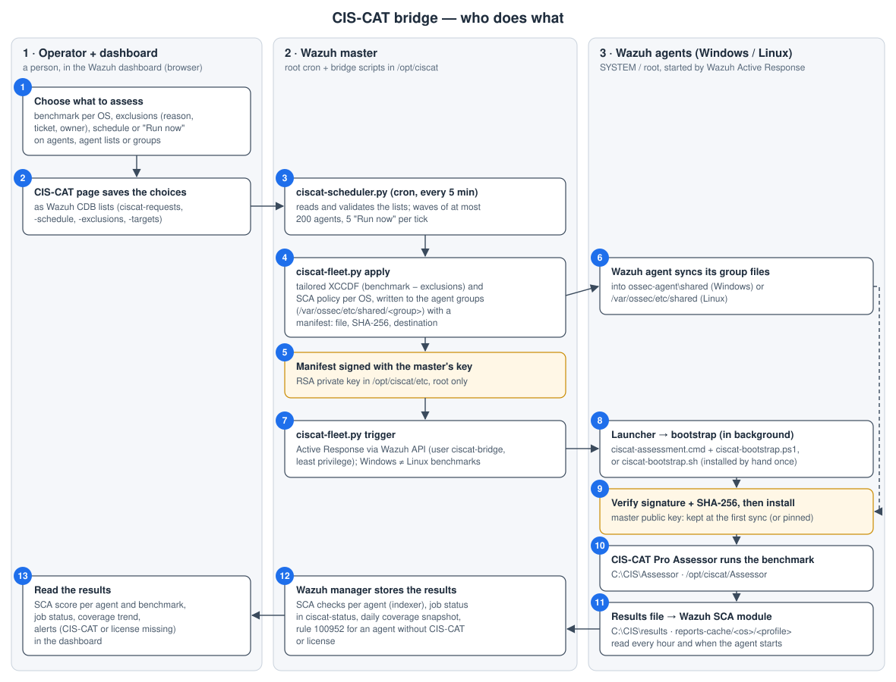

# CIS-CAT bridge

This bridge runs CIS-CAT Pro assessments on Wazuh agents and reports the results as Wazuh SCA
policies, and it is managed from the dashboard. The **CIS-CAT** tab of Configuration Assessment
edits the exclusions and the schedules. The manager applies them.

CIS-CAT Pro and the CIS benchmarks are licensed. They are not part of this repository or of the
installer:

- **The Assessor** is provisioned on each agent: `/opt/ciscat/Assessor` on Linux,
  `C:\CIS\Assessor` on Windows.
- **The benchmarks** stay in `/opt/ciscat/benchmarks` on the master.

Every CIS benchmark in that folder is an OS of the bridge, one per product and version: copy a
benchmark there and, within the hour (or at the next `ciscat-fleet.py sync`), it appears in the
dashboard with its name and version, for example
`CIS_Red_Hat_Enterprise_Linux_9_Benchmark_v2.0.0-xccdf.xml` becomes "Red Hat Enterprise Linux 9
v2.0.0" (key `rhel9_v2_0_0`). Two versions of the same benchmark are two entries, each with its own
exclusions.

In the CIS-CAT tab, **Applies to group** chooses the Wazuh group whose agents get the benchmark
(by default `os-<key>`); **Save and apply** has the master publish it to that group. Apply and runs
skip an OS until its group exists. An entry in `/opt/ciscat/etc/os-library.json` keeps its
settings (for example `"active": false`; choosing a group in the dashboard activates it again), and one whose benchmark file is missing follows the
newest version of the same product in the folder.

The bridge assesses the Level 1 profile of each benchmark, preferring the Server, Member Server or
Database Engine role. Benchmarks without `Level 1 - <role>` profiles are handled too:

- STIG benchmarks with `SEVERITY_CAT_I/II/III` profiles (`MS_`/`DC_` on Windows Server): every
  category together, role `STIG` (`Member_Server_STIG` on Windows Server);
- `Level_1` or `Level_1_L1` (Apache, Tomcat, Windows 11): that profile, role `Default`;
- `Level_1-_<Role>` (MongoDB): that profile.

`sync` lists as skipped the benchmarks of platforms without a Wazuh agent (network devices,
managed Kubernetes, cloud and SaaS services, ESXi), macOS (not handled by the bridge) and those
without a Level 1 or STIG profile. GPO benchmarks (Firefox ESR, VS Code) are Windows ones.

## How it works



| #   | Who                                                    | What                                                                                                                                                                                  | Where                                                                   |
| --- | ------------------------------------------------------ | ------------------------------------------------------------------------------------------------------------------------------------------------------------------------------------- | ----------------------------------------------------------------------- |
| 1   | Operator                                               | Chooses the benchmark of each OS, the exclusions (reason, ticket, owner), a schedule or "Run now" on agents, agent lists or groups                                                    | Dashboard, Configuration Assessment > CIS-CAT                           |
| 2   | Dashboard (CIS-CAT page)                               | Saves the choices as Wazuh CDB lists through the Wazuh API ([CONTRACT.md](CONTRACT.md))                                                                                               | `/var/ossec/etc/lists/ciscat-*` on the master                           |
| 3   | Master: `ciscat-scheduler.py` (root cron, every 5 min) | Reads and validates the lists, starts apply and runs; waves of at most 200 agents, at most 5 "Run now" per tick                                                                       | `/opt/ciscat/bin`                                                       |
| 4   | Master: `ciscat-fleet.py apply`                        | Builds the tailored XCCDF (benchmark minus exclusions) and the SCA policy of each OS, writes them with a manifest (file, SHA-256, destination) to the agent groups                    | `/var/ossec/etc/shared/<group>`                                         |
| 5   | Master                                                 | Signs each manifest with its private key, which never leaves the master                                                                                                               | `/opt/ciscat/etc` (root only)                                           |
| 6   | Wazuh agent                                            | Synchronizes the files of its groups                                                                                                                                                  | `ossec-agent\shared`, `/var/ossec/etc/shared`                           |
| 7   | Master: `ciscat-fleet.py trigger`                      | Sends the Active Response to the chosen agents through the Wazuh API (user `ciscat-bridge`, least privilege); a Windows benchmark never goes to a Linux agent and the other way round | Wazuh API                                                               |
| 8   | Agent: launcher and bootstrap                          | Start in the background so the agent's Active Response is released at once                                                                                                            | `ciscat-assessment.cmd` + `ciscat-bootstrap.ps1`, `ciscat-bootstrap.sh` |
| 9   | Agent: bootstrap                                       | Verifies the manifest signature with the master's public key, checks each file's SHA-256 in a protected staging folder, installs it                                                   | `C:\CIS`, `/opt/ciscat`, `/var/lib/wazuh-ciscat`                        |
| 10  | Agent: CIS-CAT Pro Assessor                            | Runs the tailored benchmark; the bridge turns its report into the results file                                                                                                        | `C:\CIS\Assessor`, `/opt/ciscat/Assessor`                               |
| 11  | Agent: Wazuh SCA module                                | Reads the results file every hour and when the agent starts, and evaluates the SCA policy against it                                                                                  | `C:\CIS\results`, `/var/lib/wazuh-ciscat/reports-cache/<os>/<profile>`  |
| 12  | Wazuh manager                                          | Stores the SCA results; the bridge records the job status and a daily coverage snapshot; rule 100952 alerts when CIS-CAT or its license is missing on an agent                        | Indexer, `ciscat-status`, `ciscat-history`                              |
| 13  | Operator                                               | Reads the SCA score per agent and benchmark, the job status and the coverage trend                                                                                                    | Dashboard                                                               |

Who installs what, once:

| Where         | What                                                                                               | Installed by                            |
| ------------- | -------------------------------------------------------------------------------------------------- | --------------------------------------- |
| Master        | Bridge scripts, cron, rule, API user `ciscat-bridge`, signing key, plugin                          | `ciscat-master-setup.sh`                |
| Windows agent | `C:\CIS` (ACL, owner), CIS-CAT Pro in `C:\CIS\Assessor`, launcher and bootstrap, master public key | `install-windows-agent.ps1`             |
| Linux agent   | `/opt/ciscat/Assessor` (root), bootstrap, master public key, SELinux labels                        | `install-linux-agent.sh`                |
| Every run     | Benchmarks, OVAL/CPE, assessment and conversion scripts, settings                                  | the master, through the signed manifest |

- **Benchmark files:** the `os-<os>` group carries the custom XCCDF and, under their original
  names, the benchmark's OVAL and CPE files (`-oval.xml`, `-cpe-oval.xml`,
  `-cpe-dictionary.xml`): the XCCDF checks reference them by file name. The agent copies them
  into the Assessor's `benchmarks` folder (`/opt/ciscat/Assessor/benchmarks`, or
  `C:\CIS\Assessor\benchmarks`) before the assessment, so an agent does not need
  the benchmark in its own CIS-CAT bundle.
- **Exclusions:** the scope is `os`, `global`, `host` (agent name) or `app_group` (Wazuh group).
  Every exclusion records a reason, a ticket, an owner, who made it and when.
- **Schedules:** a job runs once, monthly (day N, or N days before the month end) or weekly, in
  waves of N agents with a pause between waves. "Run now" starts a run right away. Times are in
  the manager's time zone. A run missed by more than 6 hours is reported, not run late.
- **Coverage trend:** once a day the scheduler records, per OS, how many agents of its group have a
  scan of the CIS-CAT policy from the last 35 days (`ciscat-history`). The tab shows it as a line
  chart above the tabs.
- **Status:** the tab shows the scheduler heartbeat, the last apply per OS, recent runs, and the
  disconnected agents that were skipped.

## Terraform

`terraform/` holds a module that installs the bridge and the dashboard plugin on existing Wazuh
4.14 hosts, writes the API credentials from Vault, and owns the `baseline-*` groups: their whole
`agent.conf` and the agents listed for them, written with `ciscat-fleet.py baseline --file`.
Everything else stays in the dashboard. See `terraform/README.md`.

## Production: one command

`python3 tools/ciscat-bridge/installer/build.py` writes `dist/ciscat-bridge-install-<version>.sh`
and its `.sha256`. The build is reproducible: the same sources always give the same checksum. The
script is self-contained, so copy its text to the host and run it as root. Nothing else has to be
transferred, and the master needs no network access.

On the master:

```
sh ciscat-bridge-install-<version>.sh            # install/update, migrate, sync, plan (agents untouched)
sh ciscat-bridge-install-<version>.sh --apply --restart-manager
```

What it does:

- It refuses a cluster worker and a damaged copy (the payload SHA-256 is checked before anything
  changes).
- It backs up everything it touches to `/opt/ciscat/backup/ciscat-bridge-<date>.tgz`. Restore it
  with `--rollback <file>`: the `ciscat-*` lists present at that point are kept (they hold what was
  saved in the dashboard since the backup), and only missing ones are restored. When the
  installation itself fails, the backup is restored at once, exactly.
- It installs the scripts into `/opt/ciscat/bin` and `/opt/ciscat/agent/active-response`, and the
  rule into `etc/rules/ciscat_rules.xml`. A rule ID that is already in use is refused, and the
  ruleset is tested with `wazuh-analysisd -t`.
- It creates `/opt/ciscat/etc/os-library.json` from the OS table of the `ciscat-fleet.py` in
  place. It does this only once: later updates keep the site's `active` flags.
- It migrates `/opt/ciscat/tailoring/exclusions/*.csv` to the dashboard list once. Scopes written
  by the old HTML composer are mapped: `group` → `app_group`, and `host_list` → one `host` each.
- It comments out the `ciscat-orchestrator.sh` cron entries and installs
  `/etc/cron.d/ciscat-scheduler`.
- It runs `sync` (benchmark sheets for the dashboard) and `plan`. `apply` runs only with `--apply`.

Running the same version again changes nothing.

On the dashboard host, the plugin comes from the internal repository. Its checksum is required:

```
sh ciscat-bridge-install-<version>.sh --plugin-url https://<internal-repo>/wazuh-<version>.zip \
   --plugin-sha256 <sha256 of the zip> --restart-dashboard
```

On a host that is both master and dashboard, one run does both.

API credentials come from `api_user` and `api_pass_file` in
`/opt/ciscat/etc/ciscat-orchestrator.conf` (mode 600). They are never passed on the command line:
`--password` still works but is deprecated.
The API certificate is not verified by default (the local manager API, self-signed); set
`api_ca=<CA file>` in the same file to verify it.

## Commands on the master

```
ciscat-fleet.py sync|plan|apply|report
ciscat-fleet.py trigger --targets rhel7,windows_server_2025 --wave-size 50 --wave-pause 300
ciscat-fleet.py trigger --agents 003,017          # chosen agents
ciscat-fleet.py trigger --groups web-prod,os-rhel7  # agents of OS or custom groups
ciscat-scheduler.py            # what cron runs every 5 minutes
```

Logs are in `/opt/ciscat/log/`: the scheduler log, and one log per job. Only one `apply` runs at a
time: a second one (by hand, from the installer or the scheduler) waits for it.

A run (scheduled or "Run now") reaches the agents of chosen OSes, chosen agents (one or a list),
or the agents of chosen groups (an OS group or any custom group). Each agent is reached once and
runs every benchmark of its groups. **A benchmark only goes to agents of its platform**: a Windows
benchmark never runs on, nor gives its policy to, a Linux or other Unix-like agent, and the
reverse; an agent that never connected (platform not known yet) gets nothing. Agents not reached
are listed in the job status with the reason.

Several benchmarks can apply to one group (for example two versions of a benchmark, or a custom
one next to the CIS one): each publishes its own files there (`ciscat-refresh-<os>.conf` or
`ciscat-params-<os>.txt`, and `ciscat-manifest-<os>.csv`). When a benchmark moves to another
group or stops being applied, the files it published in its old group are removed
(`/opt/ciscat/run/published.json` records them).

On the agents, `ciscat-bootstrap.sh` installs the files of every manifest only into the
Assessor's `benchmarks` folder, `/var/lib/wazuh-ciscat` and `active-response/bin/ciscat-refresh.sh`.
`ciscat-refresh.sh` runs each benchmark of `/var/lib/wazuh-ciscat/conf.d/<os>.conf` (read as
`KEY="value"` data, never sourced), with its results in `reports-cache/<os>/<profile>/`, one
assessment at a time; it drops the settings of a benchmark whose group the agent left. On
Windows, `ciscat-bootstrap.ps1` installs the files of every manifest, after checking their
SHA-256, only into `C:\CIS\Assessor\benchmarks` and `C:\CIS\bin` (the assessment and conversion
scripts come from the master too), then `C:\CIS\bin\ciscat-assessment.ps1` runs each
`ciscat-params-<os>.txt` of the shared folder.

**Agent layout** (CIS-CAT Pro is provisioned on each agent, the bridge never distributes it):

|                              | Linux and other Unix-like                                                                              | Windows                                                                                                             |
| ---------------------------- | ------------------------------------------------------------------------------------------------------ | ------------------------------------------------------------------------------------------------------------------- |
| Assessor                     | `/opt/ciscat/Assessor/Assessor-CLI.sh`                                                                 | `C:\CIS\Assessor\Assessor-CLI.bat`                                                                                  |
| Assessor setting             | `exit.on.invalid.signature=false` in `config/assessor-cli.properties` (the custom XCCDF is not signed) | same                                                                                                                |
| Installed by hand, once      | `/var/ossec/active-response/bin/ciscat-bootstrap.sh` (root:wazuh 0750)                                 | `ciscat-assessment.cmd` and `ciscat-bootstrap.ps1` in `ossec-agent\active-response\bin`                             |
| From the master, at each run | `ciscat-refresh.sh`, benchmark files, `/var/lib/wazuh-ciscat/conf.d`                                   | benchmark files (`C:\CIS\Assessor\benchmarks`), `ciscat-assessment.ps1` and `ciscat-csv-to-flat.ps1` (`C:\CIS\bin`) |
| Results                      | `/var/lib/wazuh-ciscat/reports-cache/<os>/<profile>/results.txt`                                       | `C:\CIS\results\<name>.ciscat-flat`                                                                                 |

The master's `ossec.conf` maps the Active Response commands (`<command>` and `<active-response>`
blocks; the installer reports missing or wrong ones): `ciscat-bootstrap-linux` →
`ciscat-bootstrap.sh`, `ciscat-refresh-linux` → `ciscat-refresh.sh`, `ciscat-assessment` →
`ciscat-assessment.cmd`. Runs send these command names, so the agent runs what the master maps;
a command missing from the master's `ar.conf` stops the run with an error instead of failing
silently on the agents. Windows agents get no bootstrap command.

Active Response protocol (Wazuh `os_execd`): the agent writes the alert as one JSON line on the
script's stdin and waits for the script to exit and close its stdout, running no other Active
Response meanwhile. The scripts read that line and return at once: `ciscat-refresh.sh` and the
Windows launcher start the assessment as a detached process (`--foreground` and `-Detach`), and
an assessment already running on the agent makes a new one stop (`flock` on Linux, a named mutex
on Windows). Linux agents run only the shell scripts, Windows agents only the `.cmd` and `.ps1`.

## Changes

- **2.3.0:** runs on chosen agents, lists of agents and OS or custom groups, from the dashboard
  and `trigger --agents/--groups`; the job status gives the reason for each agent not reached.
  A benchmark only goes to agents of its platform (Windows, or Linux and other Unix-like), for
  runs and policies alike. Several benchmarks can share a group: per-OS settings and manifests,
  Linux results per OS (`reports-cache/<os>/<profile>`), every benchmark of an agent runs in turn
  (Linux and Windows scripts; older agent scripts keep working through the group-wide files).
  Files a benchmark published in a group it left are removed. The `ciscat-*` groups of the
  bridge cannot be chosen as a benchmark's group. Windows runs get no bootstrap command. Runs
  send the Active Response command names configured on the master (no `!` script names, which
  bypassed the master's mapping and failed silently on Windows), and the agent scripts read the
  alert line and run the assessment detached, so the agent's Active Response is never held for
  the length of an assessment. Linux `ciscat-refresh.sh` splays only with `--splay`. Windows
  layout under `C:\CIS`: the Assessor in `C:\CIS\Assessor`, results in `C:\CIS\results`, and
  the assessment and conversion scripts published by the master and installed by
  `ciscat-bootstrap.ps1` (SHA-256 checked) in `C:\CIS\bin`; only the launcher and the bootstrap
  are installed by hand. Every combo group gets its `agent.conf` with the SCA scan interval
  (`CISCAT_SCA_INTERVAL`, default `1h`, instead of the agent's 12 hours) and loads the policy
  when the manager does not already. An agent with CIS-CAT Pro but no license reports it (same
  alert as a missing Assessor) and its old results are withdrawn.
  Windows agents store the group files with CRLF line endings: Windows files are published with
  LF only and their manifest lists the SHA-256 of the CRLF copy the agent checks.
  Manifests are signed by the master (RSA 3072, SHA-256, key created once in /opt/ciscat/etc,
  `ciscat-fleet.py key` prints it): agents install a file only from a manifest whose signature
  matches the public key their installer put in a root/Administrators-only place, and check each
  file in a protected staging folder before installing it (Windows parameters go to C:\CIS\run).
  Files the wazuh user can reach are never followed by root on the master (links refused).
  Waves are capped (200 agents, 60 s pause minimum), at most 5 "Run now" requests start per
  scheduler tick, and the handled requests are kept in a root-only file. An API without api_ca
  must be on the master itself.
  The CIS-CAT Pro license can be kept on the master (`/opt/ciscat/license/license.xml`): it then
  reaches every agent through the signed manifest, byte for byte (renewal: replace the file and
  apply). Each run logs the CIS-CAT version used.

- **2.2.9:** apply: an OS that is switched off, or whose group was removed, gives up its combo
  groups, so the agents left in them stop receiving its policy.
- **2.2.8:** scheduler: a job set in the hour repeated when daylight saving time ends runs once, a
  fast run keeps its result, and handled requests never run again. Apply: one at a time, files in
  the shared folders replaced in one step, missing benchmark files reported as errors, combo
  groups made by hand left alone. Trigger renews its API token during long runs. Agents: an empty
  or inconsistent report no longer replaces the results; bootstrap destinations limited;
  `refresh.conf` not sourced; Windows uses only the report of the current run. Installer: restores
  the backup when it fails. Terraform: `wazuh_major = 5` refused (not supported yet).
  Benchmarks are read by one XML parser (`ciscat_xccdf.py`, a DOCTYPE is refused): titles show
  `&` instead of `&amp;`, policies are generated several times faster, and the custom XCCDF is
  unchanged. `trigger` waves default to 50 agents and 300 s, as in the schedules. Run logs on
  Linux agents are limited to the last 30.

## Tests

```
python3 -m unittest discover -s tools/ciscat-bridge/tests
CISCAT_TEST_BENCHMARKS=<folder with CIS XCCDFs> python3 -m unittest tests.test_fleet_integration
python3 tools/ciscat-bridge/tests/make_vectors.py   # after a contract change; checked by Jest too
```
